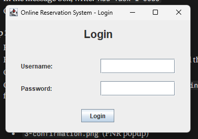
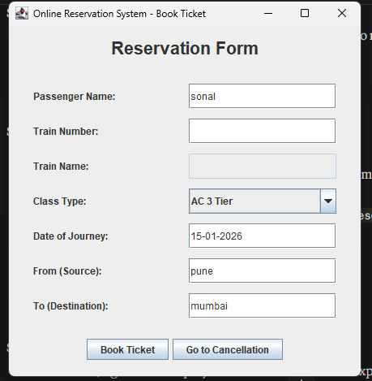
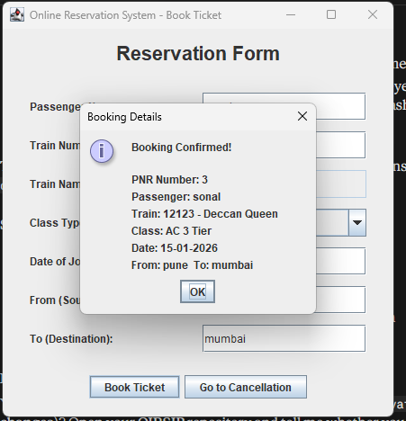
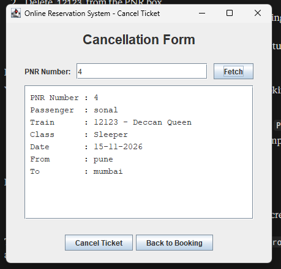
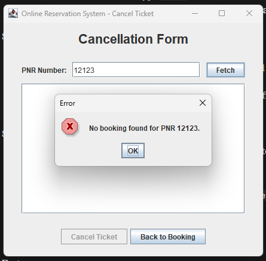

# Online Reservation System

**Internship:** Oasis Infobyte (AICTE) - Java Development
**Intern:** Sonal Bhagwan Adhav
**Task:** Task 1 - Online Reservation System

## About
A desktop application built in Java Swing with an SQLite database. Users log in, book train tickets and receive a PNR number, and can cancel a booking using that PNR.

## Features
- Login form with validation (access denied for wrong credentials)
- Reservation form: passenger name, train number, train name (auto-filled), class, date, source, destination
- Booking saved in the database with an auto-generated PNR
- Confirmation popup showing booking details
- Cancellation form: fetch booking by PNR, "Are you sure?" confirmation, then delete
- Input validation (empty fields, numeric train number, date format dd-MM-yyyy)
- PreparedStatement used everywhere to prevent SQL injection

## Technologies
- Java (Swing)
- JDBC
- SQLite

## How to Run
1. Install JDK 17 or newer.
2. Open the project folder in VS Code.
3. Make sure `lib/sqlite-jdbc-3.53.4.0.jar` is added to the project libraries.
4. Run `src/Main.java`.

**Login:** username `admin`, password `admin123`

**Sample trains:** 12123, 12126, 12301, 12951, 12009

## Project Structure
- `Database.java` - database connection, tables, queries
- `LoginForm.java` - login window
- `ReservationForm.java` - booking window
- `CancellationForm.java` - cancellation window
- `Main.java` - starts the app

## Screenshots

