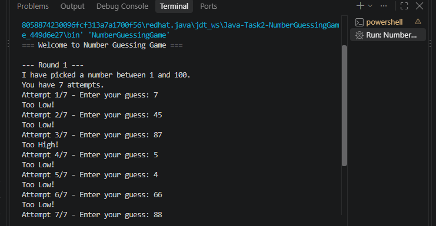
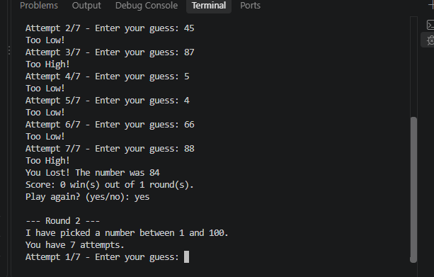
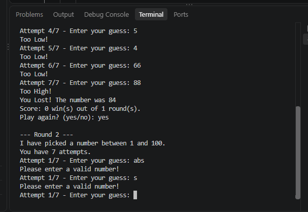

# Number Guessing Game (Java)

**Intern:** Sonal Bhagwan Adhav
**Domain:** Java Development
**Internship:** AICTE Oasis Infobyte Internship Program (OIBSIP)
**Task:** Task 2 - Number Guessing Game

## About the Project
A console-based Java game. The computer picks a random number between 1 and 100, and the player guesses it using Too High / Too Low hints.

## Features
- Random number generated for every round
- Hints: Too High!, Too Low!, Correct!
- Attempt counter with a maximum of 7 attempts
- "You Lost!" message that reveals the number
- Play Again option
- Score tracking across rounds
- Input validation for non-numeric input

## Technologies Used
- Java (Scanner, Random, loops and conditions)

## How to Run
1. Install JDK 17 or newer.
2. Compile: `javac NumberGuessingGame.java`
3. Run: `java NumberGuessingGame`

## How to Play
1. The game picks a number between 1 and 100.
2. Enter your guess and press Enter.
3. Use the hints to guess the number within 7 attempts.
4. Type `yes` to play another round or `no` to quit.

## Screenshots

**Win**

**Win (another round)**

**Lost**

## Author
Sonal Bhagwan Adhav
