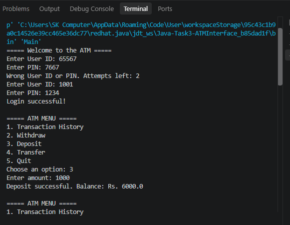
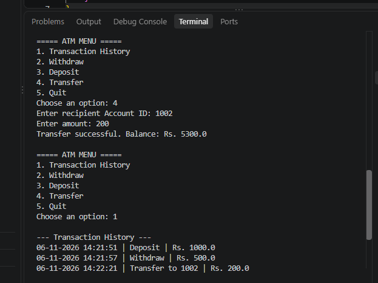
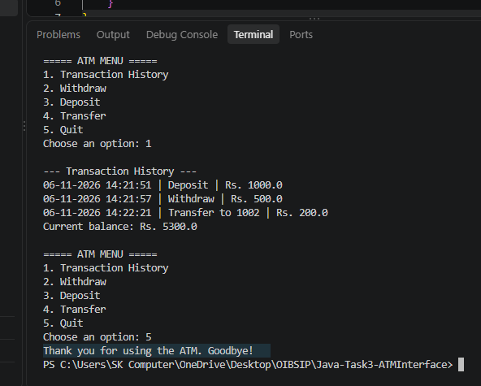

# ATM Interface (Java)

**Intern:** Sonal Bhagwan Adhav
**Domain:** Java Development
**Internship:** AICTE Oasis Infobyte Internship Program (OIBSIP)
**Task:** Task 3 - ATM Interface

## About the Project
A console-based ATM simulation built in Java using Object-Oriented Programming. The user logs in with a User ID and PIN and can perform banking operations from a menu.

## Features
- Login with User ID and PIN (access denied after 3 wrong attempts)
- Transaction History
- Withdraw (with balance check and "Insufficient Funds" message)
- Deposit
- Transfer to another account
- Quit option
- Transactions stored in an ArrayList
- Input validation for wrong or non-numeric input

## Project Structure
- `Main.java` - starts the application
- `ATM.java` - menu and user interaction
- `Account.java` - account details, balance and PIN
- `Bank.java` - stores the accounts and finds them
- `Transaction.java` - transaction record

## Technologies Used
- Java (OOP, ArrayList, Scanner, switch-case)

## How to Run
1. Install JDK 17 or newer.
2. Compile: `javac *.java`
3. Run: `java Main`

## Test Accounts
| User ID | PIN |
|---------|------|
| 1001 | 1234 |
| 1002 | 4321 |
| 1003 | 1111 |

## Screenshots

**1. Login and Menu**

**2. Transactions (Deposit, Withdraw, Insufficient Funds)**

**3. Transaction History**

## Author
Sonal Bhagwan Adhav
